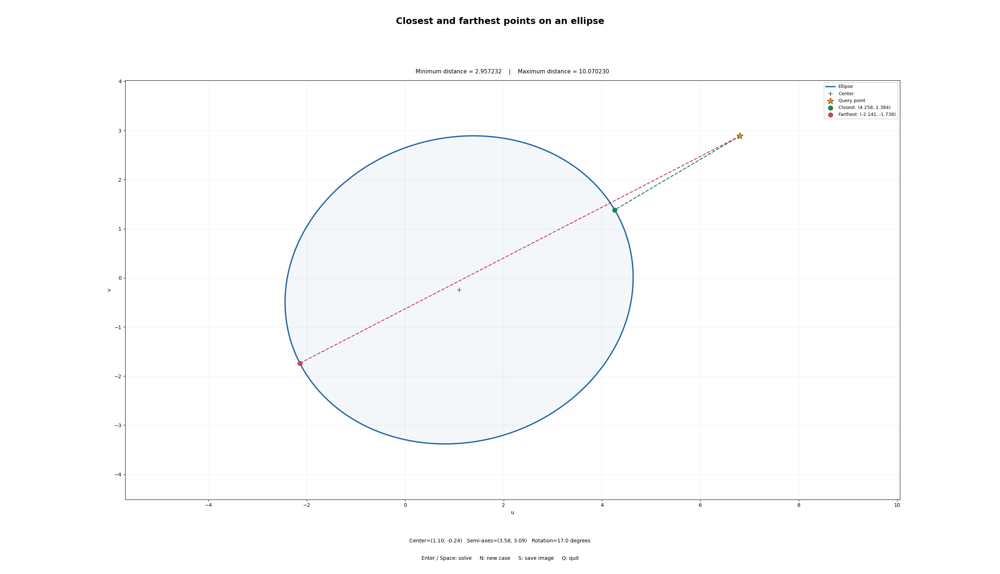
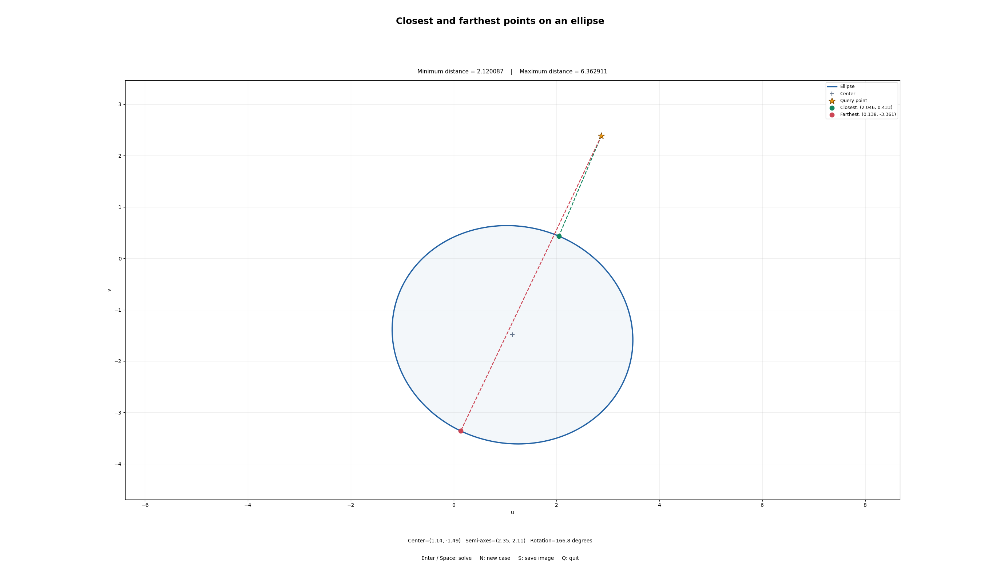
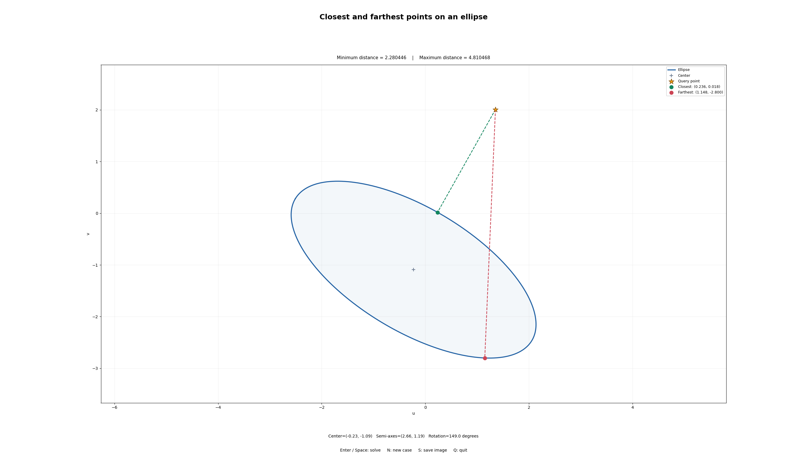
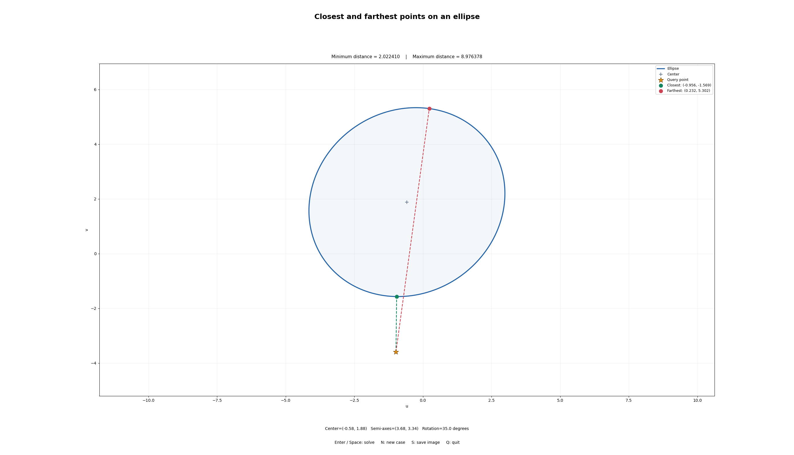
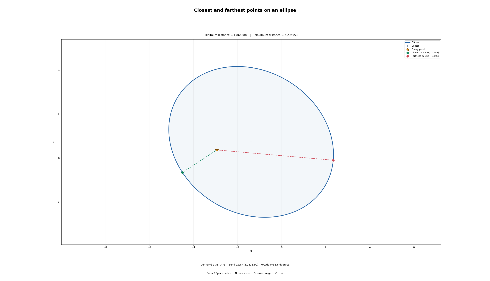

# Closest and Farthest Points on an Ellipse

Python implementation of the point–ellipse distance problem for **3D Sensing and Sensor Fusion**.

Given a 2D query point, the program finds the closest and farthest points on an ellipse boundary. It uses Lagrange multipliers to reduce the problem to a quartic polynomial, following the [course handout](https://cv.inf.elte.hu/wp-content/uploads/2024/12/PontEllipseDist.pdf).

## Features

- Generate an ellipse with a random center, semi-axis lengths and rotation.
- Generate a random query point, which may lie inside or outside the ellipse.
- Compute both extrema on a key press.
- Display the selected boundary points, connecting segments and distances.
- Handle principal-axis queries, centered queries and circles separately.

## Installation and usage

Use Python 3.10 or newer. Open a terminal in the project directory and run:

```bash
python3 -m pip install -r requirements.txt
python3 ellipse_distance.py --seed 42
```

Omit `--seed 42` for a different initial example. Click inside the plot window to give it keyboard focus.

| Key | Action |
| --- | --- |
| **Enter / Space** | Compute and draw the closest and farthest points |
| **N** | Generate a new case and clear the previous solution |
| **S** | Save the current plot as `example_result.png` |
| **Q** | Close the window |

On Windows, use `python` instead of `python3` if needed. Interactive controls require a desktop Matplotlib backend, rather than an inline notebook plot.

To export a result without opening a window:

```bash
python3 ellipse_distance.py --seed 42 --save example_result.png
```

The **S** key overwrites `example_result.png` in the current working directory. To keep multiple cases, rename each saved image before saving another.

## Mathematical method

### Lagrange formulation

The general ellipse equation is

$$
Au^2+Bv^2+Cuv+Du+Ev+F=0.
$$

Writing $\mathbf{x}=(u,v)^T$, define

$$
Q=\begin{bmatrix}A&C/2\\C/2&B\end{bmatrix},\qquad
\mathbf{g}=\begin{bmatrix}D/2\\E/2\end{bmatrix}.
$$

The constraint becomes $\mathbf{x}^TQ\mathbf{x}+2\mathbf{g}^T\mathbf{x}+F=0$. For a query point $\mathbf{x}_0$, the Lagrangian is

$$
J(\mathbf{x},\lambda)=\|\mathbf{x}-\mathbf{x}_0\|^2+
\lambda\left(\mathbf{x}^TQ\mathbf{x}+2\mathbf{g}^T\mathbf{x}+F\right).
$$

Setting its gradient with respect to $\mathbf{x}$ to zero gives

$$
(I+\lambda Q)\mathbf{x}=\mathbf{x}_0-\lambda\mathbf{g}.
$$

When the matrix is invertible, express $\mathbf{x}$ in terms of $\lambda$ and substitute it into the constraint. Clearing the denominator produces a polynomial of degree at most four. Recover the candidates from admissible real roots, then compare their distances to select the minimum and maximum.

### Coordinates used in the code

The implementation translates and rotates the ellipse into its principal-axis coordinate system and applies uniform scaling. These transformations preserve distance ordering.

For center $\mathbf{c}$, rotation matrix $R$ and semi-axes $a,b$, define

$$
s=\max(a,b),\qquad \mathbf{r}=(a/s,b/s)^T,\qquad
\mathbf{q}=R^T(\mathbf{x}_0-\mathbf{c})/s.
$$

In normalized coordinates, the ellipse is $d_1y_1^2+d_2y_2^2=1$, with $d_i=1/r_i^2$. The stationarity equations give

$$
y_i=\frac{q_i}{1+\lambda d_i}.
$$

Define

$$
P_1=q_1(1+\lambda d_2),\qquad P_2=q_2(1+\lambda d_1),\qquad
P_3=(1+\lambda d_1)(1+\lambda d_2).
$$

The quartic equation is

$$
d_1P_1^2+d_2P_2^2-P_3^2=0.
$$

Each valid candidate is transformed back using $\mathbf{x}=\mathbf{c}+sR\mathbf{y}$. `Ellipse.conic()` also returns the general conic coefficients.

`numpy.roots` calculates polynomial roots using floating-point linear algebra. The solver does not use gradient descent, a numerical minimizer or sampled boundary search. It is an algebraic candidate method, not a symbolic quartic formula.

### Special cases

The inverse formula is undefined when $\det(I+\lambda Q)=0$. Principal-axis queries are handled separately to avoid discarding valid extrema at singular multipliers. For a query at the center of a noncircular ellipse, the candidates are the four axis endpoints.

For circles, the solution is radial. At the center of a circle, every boundary point is both closest and farthest; the implementation returns representative points. If several candidates tie, one closest and one farthest representative are selected.

## Results

The five examples below show different ellipse shapes, rotations and query locations. Green points mark the closest boundary points; red points mark the farthest. The orange star is the query point.

| Case | Query location | Minimum distance | Maximum distance |
| --- | --- | ---: | ---: |
| 1 | Outside | 2.957232 | 10.070230 |
| 2 | Outside | 2.120087 | 6.362911 |
| 3 | Outside | 2.280446 | 4.810468 |
| 4 | Outside | 2.022410 | 8.976378 |
| 5 | Inside | 1.866888 | 5.296953 |

Distances are expressed in the plot's coordinate units.

### Case 1 — Exterior query



The query lies above and to the right of the ellipse. The closest point is approximately `(4.258, 1.384)`, while the farthest is `(-2.141, -1.738)`. This is the reproducible initial example generated with `--seed 42`.

### Case 2 — Nearly circular ellipse



The semi-axes are approximately `2.35` and `2.11`. The two connecting segments are nearly aligned, consistent with the ellipse being close to circular. The closest point lies on the upper-right boundary, while the farthest point lies on the lower boundary.

### Case 3 — Elongated and rotated ellipse



The semi-axes are approximately `2.66` and `1.19`, with a rotation of `149°`. The two connecting segments have visibly different directions. This illustrates why the extrema generally cannot be obtained simply by intersecting the center–query line with the ellipse.

### Case 4 — Query below the ellipse



The closest point is on the lower boundary at approximately `(-0.956, -1.569)`, and the farthest point is near the upper boundary at `(0.232, 5.302)`. The same method applies when the query is below the ellipse.

### Case 5 — Interior query



The query lies inside the ellipse. The closest and farthest points are approximately `(-4.498, -0.658)` and `(2.339, -0.100)`. The minimum distance is positive because the task measures distance to the **ellipse boundary**, not to the filled interior region.

## Validation

Run the automated checks with:

```bash
MPLBACKEND=Agg python3 -m unittest -v test_solver.py
```

On Windows PowerShell:

```powershell
$env:MPLBACKEND="Agg"
python -m unittest -v test_solver.py
```

The tests cover:

- Known center and circle solutions.
- Principal-axis and boundary queries.
- The ellipse constraint and Lagrange stationarity condition.
- 200 random cases compared with an independent dense boundary sample, allowing for sampling error.
- Keyboard callbacks for solving and generating a new case.

All five test methods passed in the preparation environment. Dense sampling is used only for validation, never by the solver. The result images illustrate the application output; images alone do not establish numerical accuracy.

## Project files

| Path | Description |
| --- | --- |
| `ellipse_distance.py` | Solver and interactive visualization |
| `requirements.txt` | Python dependencies |
| `test_solver.py` | Automated checks |
| `Results/` | Five example result images |
| `HUONG_DAN_VI.md` | Vietnamese explanation and usage notes |
| `README.md` | Project overview, method and results |

## Numerical limitations

Floating-point polynomial roots can become unreliable for extremely eccentric ellipses, nearly repeated roots or extreme coordinate magnitudes. The demonstration generates moderate semi-axis lengths in `[1, 4]` and query offsets from the center in `[-6, 6]` per coordinate. Small tolerances identify axis and circle cases, and constraint checks reject invalid candidates.

## Reference

[Point-ellipse distance](https://cv.inf.elte.hu/wp-content/uploads/2024/12/PontEllipseDist.pdf), course handout, December 10, 2024.
